# VA-MAS

VillagerAgent(VA)와 MineSkynet 연구 코드를 관리하는 저장소입니다. TD(계획), AC(배정), 상태 관리, BA(실행), 환경 judger의 책임과 계측 경계를 구분합니다. 연구 질문·판정은 [연구 안내](doc/research/README.md), 구조 정리의 범위·검증 결과는 [리팩토링 기록](doc/refactoring.md)을 확인하세요. 현재 RQ는 생성형 계획을 유지한 BA 행동 선택·AC 배정의 결정형 정책 분리이며, 연구자가 2026-11-04에 확정했습니다.

실제 환경 검증은 [2026-11-04 smoke 보고서](doc/live_smoke_2026-11-04.md)에 기록했습니다.

## 설치와 선택 기능

현재 코드는 Python 3.10 이상을 기준으로 합니다. 아래 명령은 새 환경을 직접 준비할 때 사용하는 안내이며, 저장소에 환경·Minecraft 서버·모델 가중치가 포함되지는 않습니다.

```bash
git clone https://github.com/Saturn294571/VA-MAS.git
cd VA-MAS
python -m venv .venv
.venv/bin/python -m pip install -r requirements/base.txt
npm install
```

기본 Python 목록은 Gemini·Ollama와 일반 실행/프로브 의존성을 포함합니다. 실제 Construction 실행의 구조 분할에는 추가 임베딩 패키지가 필요합니다. 설치·모델 다운로드는 별도 비용과 환경 준비가 수반됩니다.

| 기능 | 추가 설치 목록 | 기존 진입점·선택 |
| --- | --- | --- |
| Construction 임베딩 | `requirements/construction.txt` | Construction judger의 구조 분할 |
| PPO/DQN | `requirements/rl.txt` | `rl_env`, BA의 `RL_mode`, 자동 과제 생성 |
| Hugging Face 로컬 추론 | `requirements/huggingface.txt` | 모델 팩토리의 기존 모델명 선택 |
| Zhipu 등 추가 공급자 | `requirements/providers.txt` | 기존 공급자 어댑터 |
| FastAPI 대안 서버 | `requirements/fastapi.txt` | `fast_api=True`; 기존 미완성 경로 |
| 과거 vector-store 검색 | `requirements/retrieval.txt` | 유틸리티의 호환 검색 함수 |
| 결과·학습 자료 가공 | `requirements/analysis.txt` | `result/`의 기존 분석 스크립트 |

예: `.venv/bin/python -m pip install -r requirements/construction.txt`. 루트 `requirements.txt`는 위 선택 기능을 포함하는 전체 호환 목록입니다. 기존 버전 pin은 유지했지만, 새 환경 설치와 전체 의존성 해석은 이번 리팩토링에서 검증하지 않았습니다. VLLM 어댑터는 OpenAI 호환 HTTP 클라이언트이며 서버 설치를 포함하지 않습니다.

## 실행과 오프라인 검증

- `start_with_config.py`: benchmark 실행. `VILLAGER_BENCH_CONFIG_PATH`로 설정 파일을 지정합니다. `examples/ollama_construction_task6.json`은 기존 예시이며 Minecraft·Ollama 서버가 필요합니다.
- `tiny_start.py`: 최소 파이프라인 예제. `agent_demo.py`: 수동 actor 행동 예제.
- `td_ac_probe.py`: 합성 상태에서 TD/AC만 검사하며 Minecraft 완료 점수는 만들지 않습니다.
- `verification/run_offline.py`: 각 검사를 임시 폴더에서 실행하고 외부 socket 연결을 차단합니다. 기존 로그·월드 초기화나 외부 API 호출 없이 검사합니다.

```bash
.venv/bin/python -B verification/run_offline.py
.venv/bin/python -B td_ac_probe.py --self-test --output /tmp/va-probe-example
```

실행 설정의 `controller_mode`, `assignment_policy`, `model_roles`, `decision_policies`와 기존 기본값은 보존합니다. Full/Tiny Controller의 public import 경로도 유지합니다. Full은 다중 agent·종료 예산을 다루고 Tiny는 직접 배정과 기존 worker 동작을 유지합니다. 현재 AC `decision` 선택은 구현되지 않아 실행기가 거부하며, 리팩토링이 이를 대신 구현하지는 않습니다.

Gemini 키는 환경 변수로만 제공하고 추적 파일에 기록하지 마세요. 모델 cache·token·trace의 경로와 형식, 입력 자산 및 과거 실험 결과는 유지했습니다. 실제 실행은 서버 상태와 기존 증거 보존 여부를 확인한 뒤 진행해야 합니다.

## 원본 VillagerAgent 자료

아래는 [원본 VillagerAgent](https://github.com/cnsdqd-dyb/VillagerAgent)의 소개·사용법입니다. 과거 설치·Docker 안내를 포함하므로 VA-MAS의 현재 실행은 위 안내와 연구 문서를 우선하세요. 제공된 Dockerfile은 존재하지 않는 `run.py`를 가리키며 현재 실행·빌드는 검증하지 않았습니다. `.dockerignore`는 로컬 환경·월드·결과·인증 파일의 빌드 포함을 제한합니다.

---

# 🏰 VillagerAgent: A Graph-Based Multi-Agent Framework for Coordinating Complex Task Dependencies in Minecraft 🌍

 

<!-- <style>
.showcase-table {
    width: 100%;
    border-spacing: 10px;
    border-collapse: separate;
}

.showcase-cell {
    width: 25%;
    padding: 10px;
    background: #f5f5f5;
    border-radius: 8px;
    transition: transform 0.2s;
}

.showcase-cell:hover {
    transform: scale(1.02);
    box-shadow: 0 4px 8px rgba(0,0,0,0.1);
}

.showcase-image {
    width: 256px;
    height: 256px;
    object-fit: cover;
    border-radius: 4px;
    margin-bottom: 8px;
}

.showcase-title {
    font-size: 14px;
    color: #333;
    margin-top: 8px;
    font-weight: 500;
}
</style> -->

<table class="showcase-table">
    <tr>
        <td class="showcase-cell" align="center">
            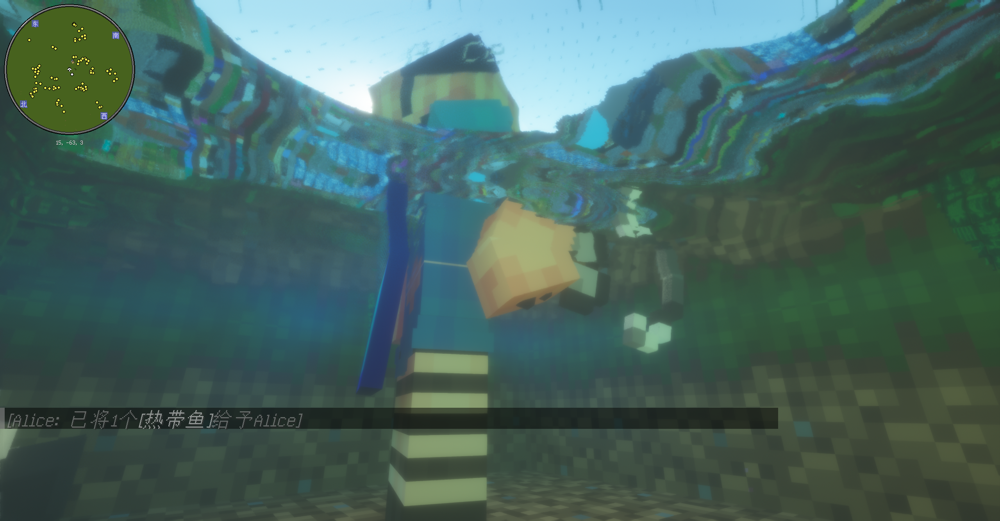<br>
            <sub class="showcase-title">Fishing</sub>
        </td>
        <td class="showcase-cell" align="center">
            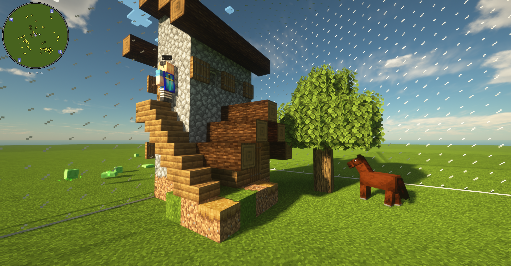<br>
            <sub class="showcase-title">Building</sub>
        </td>
        <td class="showcase-cell" align="center">
            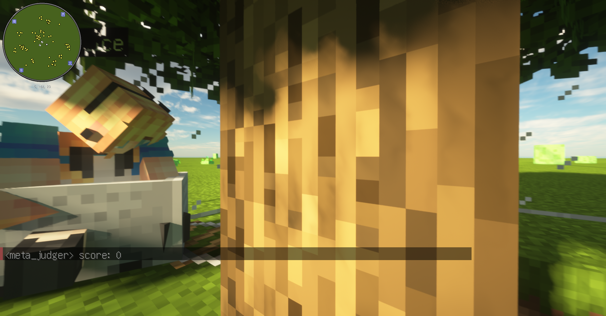<br>
            <sub class="showcase-title">Driving</sub>
        </td>
        <td class="showcase-cell" align="center">
            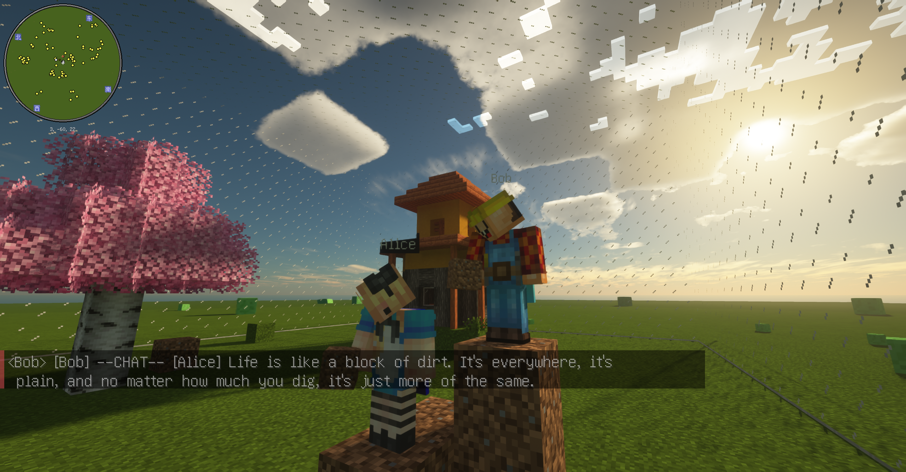<br>
            <sub class="showcase-title">Talking</sub>
        </td>
    </tr>
    <tr>
        <td class="showcase-cell" align="center">
            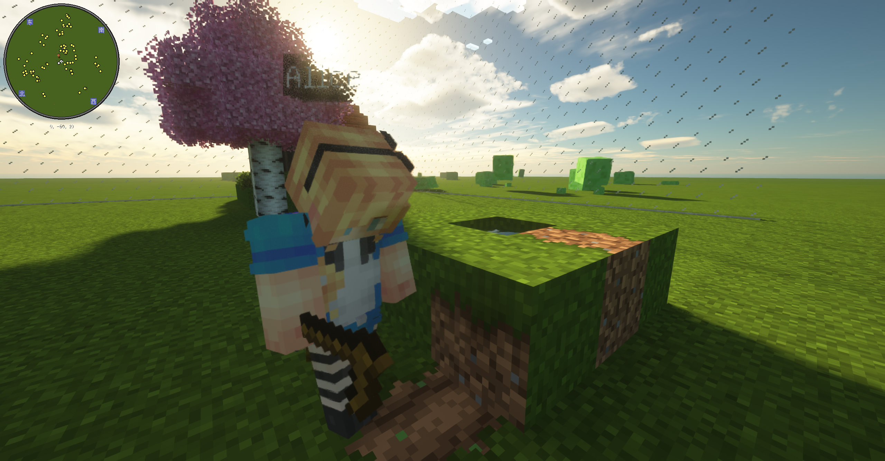<br>
            <sub class="showcase-title">Farming</sub>
        </td>
        <td class="showcase-cell" align="center">
            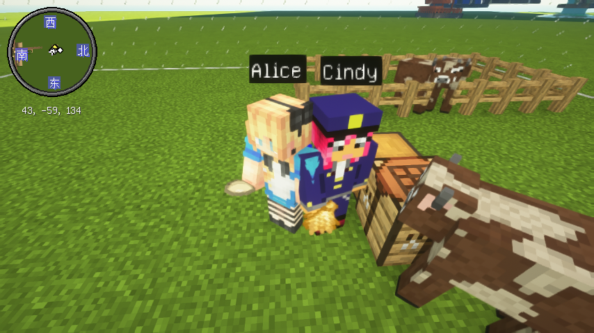<br>
            <sub class="showcase-title">Feeding</sub>
        </td>
        <td class="showcase-cell" align="center">
            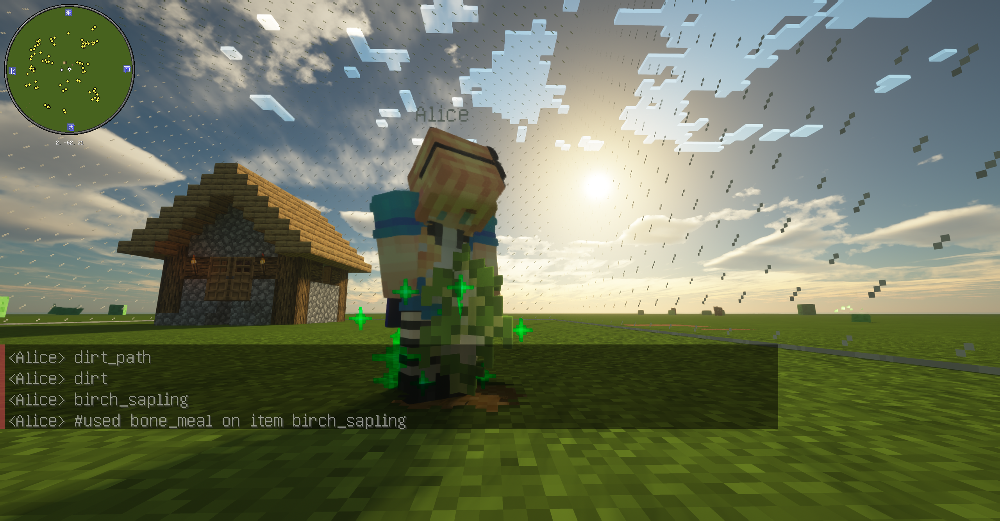<br>
            <sub class="showcase-title">Cultivate</sub>
        </td>
        <td class="showcase-cell" align="center">
            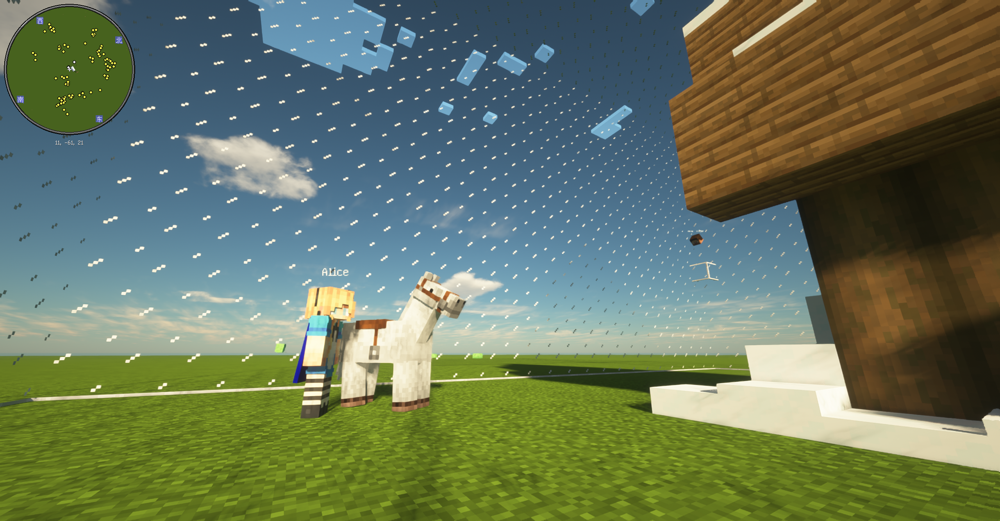<br>
            <sub class="showcase-title">Holding</sub>
        </td>
    </tr>
    <tr>
        <td class="showcase-cell" align="center">
            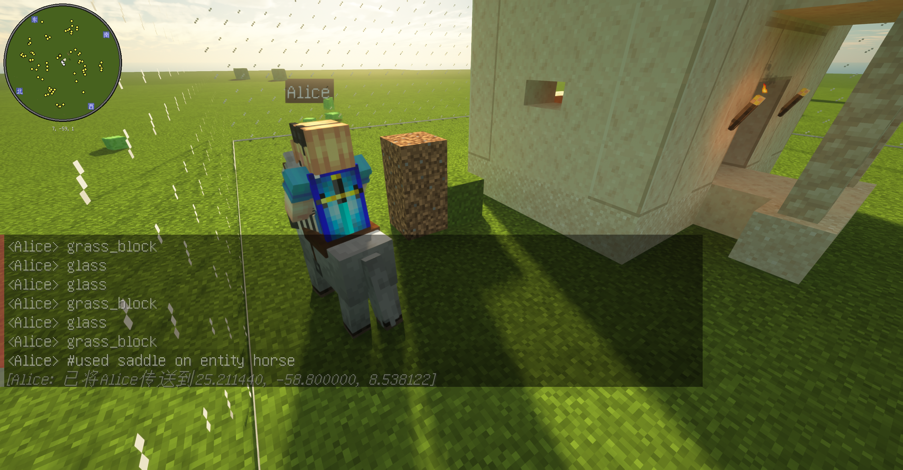<br>
            <sub class="showcase-title">Riding</sub>
        </td>
        <td class="showcase-cell" align="center">
            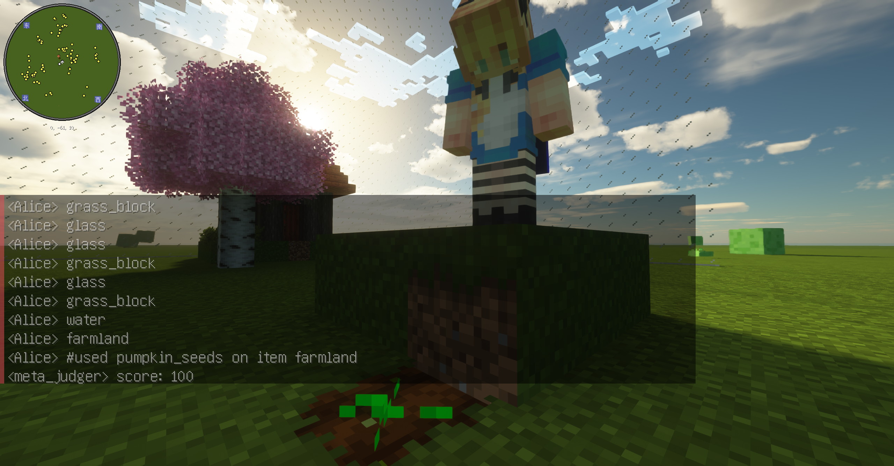<br>
            <sub class="showcase-title">Seeding</sub>
        </td>
        <td class="showcase-cell" align="center">
            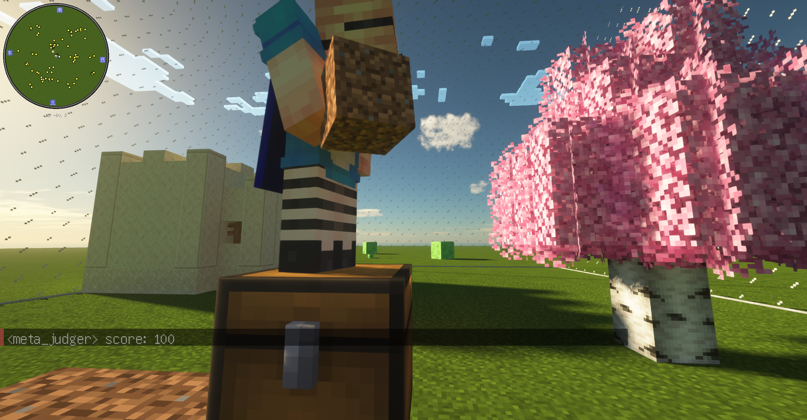<br>
            <sub class="showcase-title">Storing</sub>
        </td>
        <td class="showcase-cell" align="center">
            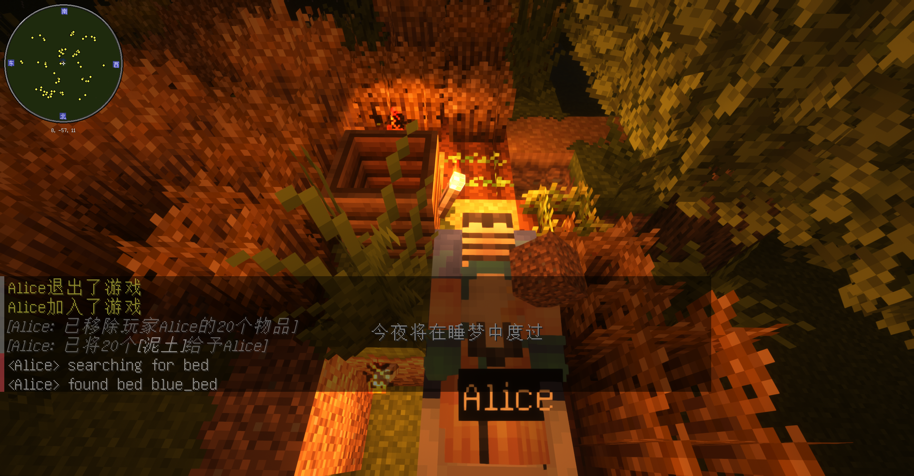<br>
            <sub class="showcase-title">Sleeping</sub>
        </td>
    </tr>
</table>


We aim to investigate the interactions between agents within the Minecraft environment and their collaboration with human players. Concurrently, we will explore the capabilities of Large Language Models (LLMs) in task decomposition and cooperation.

Welcome to VillagerBench, where the blocky world of Minecraft isn't just for fun and games—it's a testing ground for the cutting-edge of multi-agent collaboration! 🤖 Our benchmark suite is designed to push the boundaries of what virtual agents can achieve together, tackling everything from construction projects 🏗️ to culinary quests 🍳 and escape room puzzles 🔐.

Customize your private tasks in your Minecraft server with our VillagerAgent multi-agent framework, designed for personalized gameplay experiences! 🌟 
点击此处查看 [中文版 README](READMEzh.md)。
クリックして [README](README.md) をご覧ください。
<p align="center">
    <a href='https://arxiv.org/abs/2406.05720'>
      
    </a>
    <a href='https://cnsdqd-dyb.github.io/workshare/2024/04/01/VillagerAgent.html'>
      
    </a>
</p>

---

## News
\[2024.12.18\] We've added new attributes. VillagerBaseAgent LLM 8b v1 will be released soon.

\[2024.12.11\] Support LLM api ranking with PPO method.

\[2024.12.08\] LLM driven AutoGen task to get data for Agent-tuning.

<table> <tr> <td>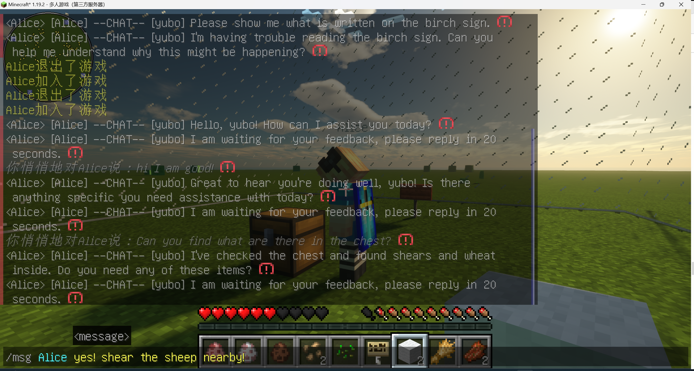</td> <td>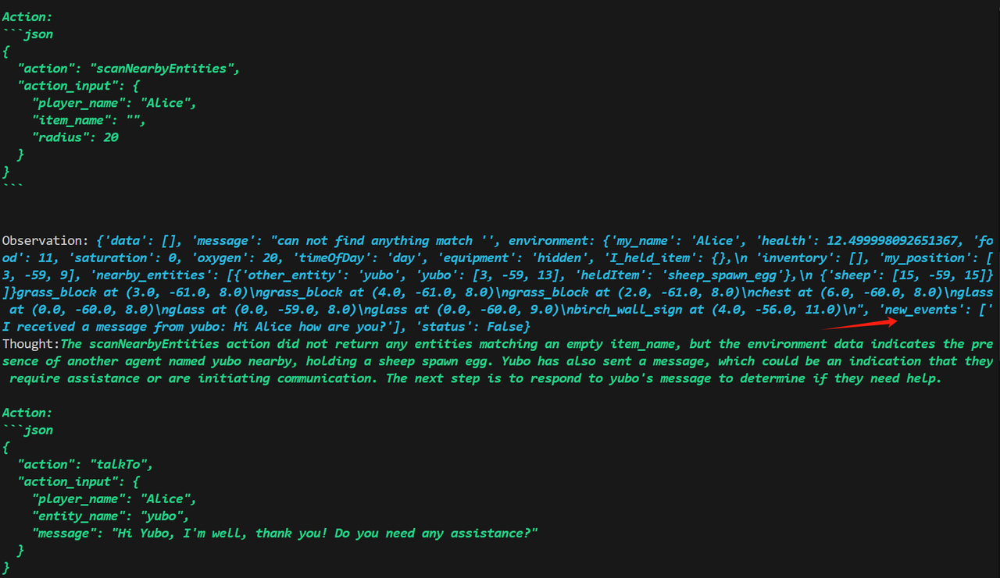</td> </tr> <tr> <td>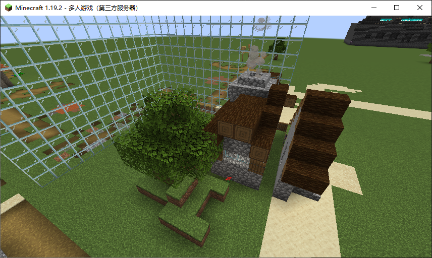</td> <td>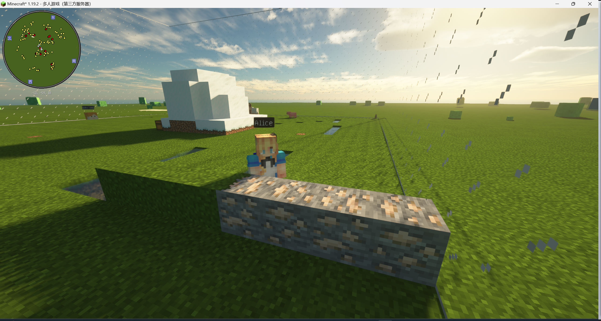</td> </tr> </table>

\[2024.12.01\] \[Human -- Agent\]  \[Agent -- Agent\] Real Time Chat supports now!!!🎉

<table> <tr> <td>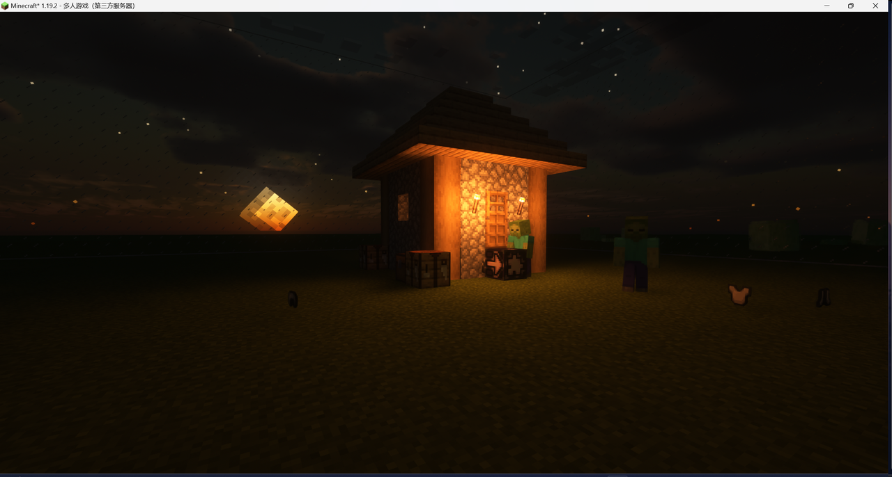</td> <td>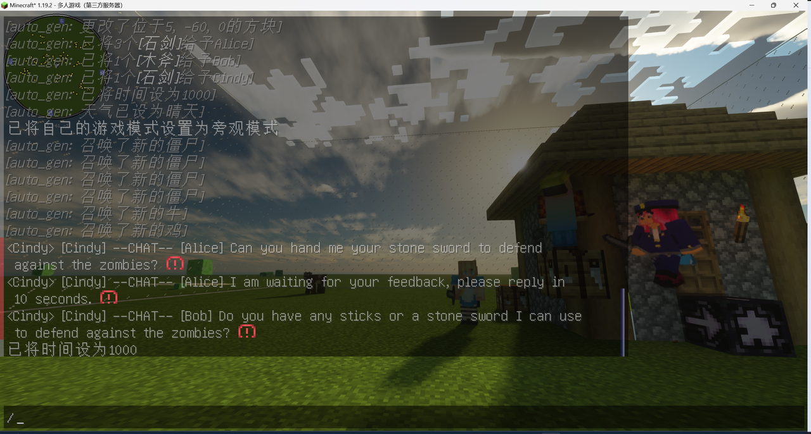</td> </tr>  </table> 

\[2024.10.23\] We are trying to replace the LLM in VillagerAgent with finetuned open source LLMs to improve the performance and efficiency of the agent's task execution.

\[2024.10.04\] 🎉Our minecraft multi-agent framework VillagerAgent has been accepted by ACL 2024.
## Setup and Configuration 🛠️

### Requirements
- **Python Version**: Python 3.8 or newer installed on your system.
- **API Keys**: Obtain API keys from one or more of the following services:
  - Alibaba Cloud Model Studio (for access to Qwen models)
  - OpenAI (for access to models like GPT-4)
  - Google Cloud (for access to models like Gemini)
  - Zhipu AI (for access to GLM models)
- **Node.js and npm**: Node Package Manager (npm) installed, which is typically included with Node.js.
- **Minecraft Server**: A Minecraft 1.19.2 server running locally or on a reachable host. For local quickstart, use `localhost:25565`. If you want to know how to configure the Minecraft 1.19.2 server, please see the [tutorial here](#minecraft-1192-server-setup).
- **Python Dependencies**: Install all necessary Python libraries as specified in the `requirements.txt` file. You can install these dependencies using the following command:
  ```
  pip install -r requirements.txt
  ```
- **Other Model Choice**: You have the option to use models from Hugging Face's Transformers library. Ensure you have the necessary credentials to use and download the model.

### Installation Steps
1. Clone the repository 📦:
   ```bash
   git clone https://github.com/cnsdqd-dyb/VillagerAgent.git
   ```
2. Opt for a virtual environment 🧹:
   ```bash
   python -m venv venv
   source venv/bin/activate  # On Windows, try venv\Scripts\activate
   ```
3. Install the dependencies 🧑‍🍳:
   ```bash
   pip install -r requirements.txt
   npm install
   python js_setup.py
   ```
4. Set up your API key 🗝️:
   - Export a paid-tier Google Gemini API key in your shell. Do not commit it:
   ```bash
   export GEMINI_API_KEY="your Google Gemini API key"
   ```
   - `GOOGLE_API_KEY` is accepted as a compatibility fallback, but
     `GEMINI_API_KEY` is the documented project setting.

## QuickStart 🚀

1. Start a Minecraft 1.19.2 server and make sure it is reachable at `localhost:25565`.
2. Run the minimal example:
   ```bash
   python tiny_start.py
   ```
3. After `Alice` joins the server, grant it operator permission in the Minecraft server console:
   ```text
   /op Alice
   ```

The default model settings are defined near the top of `tiny_start.py`:

```python
LLM_API_BASE = "https://generativelanguage.googleapis.com/v1beta/openai/"
LLM_API_MODEL = "gemini-3.8-flash"
LLM_THINKING_LEVEL = "low"
```

Google-specific authentication, thinking configuration, token accounting and
embeddings are isolated in `model/google_model.py`. The adapter uses Google's
official OpenAI-compatible endpoint and the existing `openai` dependency; it
does not require a separate Google model SDK.

For an explicit run configuration, set `VILLAGER_LLM_MODEL`,
`VILLAGER_LLM_THINKING_LEVEL`, `VILLAGER_ACTOR_MAX_TOKENS` and
`VILLAGER_EMBEDDING_MODEL`. Their defaults are the values shown above, `512`
and `gemini-embedding-001`, respectively.

If your Minecraft server is not local, update `MINECRAFT_HOST` and `MINECRAFT_PORT` in `tiny_start.py`.

### Batch Testing 🧪
- Whip up test configs with `config.py` 📝.
- Kick off automated batch testing with `start_with_config.py` 🤖.


### Docker 🐳
- Build your Docker image with `docker build -t VillagerAgent .` 🏗.
- Launch the Docker container with `docker run VillagerAgent` 🚀.
- Note: If you need to open specific ports for API connectivity, you may need to modify the Dockerfile accordingly and launch with `docker run -p <your_port>:<app_port> VillagerAgent` 🌐.

## Overview 📜

### VillagerBench
Dive into VillagerBench, powered by Mineflayer, to explore the dynamics of cooperative AI. Our agents don't just play—they learn 🎓, adapt 🔄, and work together to overcome challenges that would stump the lone wolf 🐺.

 
 

### VillagerAgent Framework
Meet VillagerAgent, our multi-agent maestro 🎼, orchestrating a symphony of tasks with its four core components: Task Decomposer, Agent Controller, State Manager, and Base Agents. It's like a conductor for AI, turning individual actions into a masterpiece of collaboration.

 

## Core Components 🌟

- **VillagerBench**: The virtual sandbox where agents interact and learn 🤹.
- **TaskManager**: The master planner, keeping tasks on track and agents in the know 📊.
- **DataManager**: The keeper of knowledge, holding all the data cards close to its chest 🗃️.
- **GlobalController**: The overseer, ensuring every agent plays their part to perfection 🎯.


## npm Installation
### Windows

1. **Download the Node.js Installer**:
   - Visit the [Node.js official website](https://nodejs.org/).
   - Download the latest stable version of the Node.js installer for Windows (the LTS version is usually recommended).

2. **Run the Installer**:
   - Double-click the downloaded installer file.
   - Follow the instructions provided by the installation wizard. Make sure to include all necessary components, including npm, during the installation process.

3. **Verify Installation**:
   - Open Command Prompt or PowerShell.
   - Enter the following commands to check the versions of Node.js and npm:
     ```
     node -v
     npm -v
     ```
   - If the installation was successful, you will see the version numbers of Node.js and npm displayed.

### Linux (Debian/Ubuntu-based)

1. **Install Using Package Manager**:
   - Open the terminal.
   - First, update your package index:
     ```
     sudo apt update
     ```
   - Install Node.js and npm:
     ```
     sudo apt install nodejs npm
     ```

2. **Install Using nvm** (Node Version Manager, recommended for managing multiple versions of Node.js):
   - Open the terminal.
   - Install nvm by running:
     ```
     curl -o- https://raw.githubusercontent.com/nvm-sh/nvm/v0.39.1/install.sh | bash
     ```
   - Restart the terminal or run the following command to update the current session:
     ```
     export NVM_DIR="$([ -z "${XDG_CONFIG_HOME-}" ] && printf %s "${HOME}/.nvm" || printf %s "${XDG_CONFIG_HOME}/nvm")"
     [ -s "$NVM_DIR/nvm.sh" ] && \. "$NVM_DIR/nvm.sh" # This loads nvm
     ```
   - Install Node.js using nvm (this will also install npm):
     ```
     nvm install node
     ```

3. **Verify Installation**:
   - Type the following commands to check the versions of Node.js and npm:
     ```
     node -v
     npm -v
     ```
   - If the installation was successful, you will see the version numbers of Node.js and npm displayed.


## Minecraft 1.19.2 Server Setup
### Preparation

1. **Ensure Java is Installed**: Minecraft servers require the Java runtime environment. Make sure you have the latest version of Java installed on your computer. You can check if Java is installed by running `java -version` in the command line.

2. **Download Server File**: Visit the official Minecraft website to download the 1.19.2 version of the server file (`minecraft_server.1.19.2.jar`).

### Configuring the Server

1. **Create a Server Folder**: Choose a location on your computer to create a new folder that will hold all the Minecraft server files.

2. **Move Server File**: Move the downloaded server file (`minecraft_server.1.19.2.jar`) into the folder you created.

3. **Run the Server**:
   - Open the command line interface.
   - Navigate to the folder containing the server file using the `cd` command.
   - Run the following command to start the server:
     ```
     java -Xmx1024M -Xms1024M -jar minecraft_server.1.19.2.jar nogui
     ```
   - The `-Xmx1024M` and `-Xms1024M` parameters set the maximum and initial memory allocation for the server in megabytes (MB). You may need to adjust these values based on your server's hardware.

4. **Accept the EULA**: The first time you run the server, a file named `eula.txt` will be generated. Open this file and change `eula=false` to `eula=true` to accept the Minecraft End User License Agreement.

5. **Restart the Server**: Run the `java` command again to start the server.

### Configuring Server Properties

1. **Edit the `server.properties` File**: After the first server run, a configuration file named `server.properties` will be generated. You can edit this file to customize the server settings, such as game mode, difficulty, etc. If you are testing the capabilities of multiple agents on VillagerBench, set the mode to peaceful and the terrain to superflat.

2. **Port Forwarding**: If you want other players to be able to access your server from outside networks, you may need to set up port forwarding on your router. By default, the Minecraft server uses port 25565.

3. **Start and Test the Server**: After completing all the settings, restart the server and try connecting to it to ensure everything is running smoothly.

### Important Notes

- Ensure that any agents that may join the server have been granted admin privileges (you can add permissions with the command `/op agent_name`).
- Make sure your server's firewall rules allow the port used by the Minecraft server.
- Regularly back up your server files to prevent data loss.
- Keep the server's Java version up to date for optimal performance and security.

The steps above provide a basic tutorial for setting up a Minecraft server. Depending on your specific needs and configuration, more advanced settings may be required.

## Citation
🌟 If you find our work helpful, please leave us a star and cite our paper.
```
@inproceedings{dong2024villageragent,
  title={VillagerAgent: A Graph-Based Multi-Agent Framework for Coordinating Complex Task Dependencies in Minecraft},
  author={Dong, Yubo and Zhu, Xukun and Pan, Zhengzhe and Zhu, Linchao and Yang, Yi},
  booktitle={Proceedings of the 62nd Annual Meeting of the Association for Computational Linguistics (ACL)},
  year={2024},
  url={https://arxiv.org/abs/2406.05720}
}

```

## Contribution Guide 🤝

Jump on board! We love contributions. Before you submit your pull request, make sure:
- Your changes have aced the tests 🏆.
- You've spruced up the docs (if you've added some pizzazz) 📚.

## License 📜

This project is all yours under the [MIT License](LICENSE).
