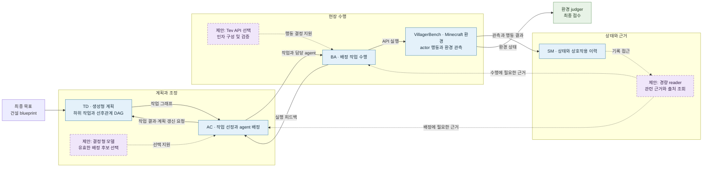

## 11.4 랩미팅

### VA MAS pipeline 추상화

생성형 TD의 계획을 유지하면서 AC의 제한된 배정과 BA의 행동 선택을 분리하고, S1-MAS reader의 근거 접근 아이디어를 SM에 적용하는 연구 방향이다. 아래는 **현재 코드의 구조와 제안을 함께 나타낸 수도코드**다. `H_`로 시작하는 이름은 아직 구현을 확정하지 않은 가상 제안이다. [VA 논문–코드 대응](../architecture_understand/VA_code_paper_map.md), [논의와 근거](report_log.md).

예시 목표는 Alice·Bob·Cindy가 재료를 준비하고 바닥과 양쪽 벽을 건설하는 것이다. `재료 준비 → 바닥 → 양쪽 벽(병렬 가능) → 완성 확인`의 선후관계는 설명을 위한 가정이며 특정 benchmark 실행에서 관찰된 DAG가 아니다.

**표기:** 각 nested class는 분류용이다. `GlobalController.Scheduling.execute_tasks(controller)`처럼 바깥 인스턴스를 명시하는 표현은 메서드의 분류 위치를 보여 주는 수도코드다. 실제 코드는 호환 별칭인 `controller.execute_tasks()`를 호출하며, nested class의 객체를 따로 만들지 않는다. 인자와 반환값은 이해를 위해 축약했다.

#### `start_with_config.py` — 객체 구성과 시작

```python
# start_with_config.py
def run(...):
    env = VillagerBench(...)
    env.agent_register(...)                   # Minecraft actor 등록
    with env.run():                           # 환경·judger 수명주기
        dm = DataManager(...)
        DataManager.Updates.update_database_init(dm, env.get_init_state())
        tm = TaskManager(...)
        ctrl = GlobalController(..., tm, dm, env)  # 내부에서 BA 생성
        TaskManager.Planning.init_task(tm, goal, document)
        ctrl.run()                            # 상속받은 ControllerExecution.run
        env.get_score()                       # 환경 점수 조회
```

#### `pipeline/task_manager.py` — `TaskManager` (TD)

생성형 모델이 목표·환경 정보로 작업과 선후관계를 구성한다. 실제 계획은 시나리오와 모델 응답에 따라 달라진다. 피드백 이후 작업 갱신과 재분해도 담당한다.

```python
# pipeline/task_manager.py
class TaskManager:
    def __init__(self, ...):
        self.graph = ...

    class Planning:
        def init_task(self, description, document):
            state = DataManager.Queries.query_env_with_task(self.dm, description)
            # 생성형 모델로 하위 작업을 만들고 그래프 구성

        def feedback_task(self, task):
            ...  # 결과를 반영하고 필요한 갱신 수행

        def update_task(self, task):
            ...  # 재분해 경로

    class TaskGraph:
        def query_subtask_list(self):
            ...  # Controller가 현재 작업을 조회
```

#### `pipeline/controller.py`와 `pipeline/controller_execution.py` — `GlobalController` (AC)

실제 Controller는 준비 상태·후보·가용성을 확인하고 조건에 따라 직접 배정하거나 생성형 모델의 배정 제안을 검증한다. 현재 결정형 AC는 미구현이다. 아래 `H_`는 제한된 후보에서 결정하는 향후 방향이다.

```python
# pipeline/controller.py
class GlobalController(ControllerExecution):
    def __init__(self, ..., task_manager, data_manager, env):
        self.task_manager = task_manager
        self.data_manager = data_manager
        self.agent_list = [BaseAgent(...) for actor in env.agent_pool]
        ...  # 큐·실행기 및 공유 상태 초기화

    class Scheduling:
        def execute_tasks(self):
            tasks = TaskManager.TaskGraph.query_subtask_list(self.task_manager)
            ready = GlobalController.Scheduling.check_task_list_available(self)
            ...  # 직접 배정 또는 생성형 배정 제안 경로

        def check_task_list_available(self):
            ...  # 선행관계·작업 상태·가용 agent 확인

        def H_select_assignment(self, ready, evidence):
            ...  # 가설: 유효한 작업·agent 후보 중 결정형 모델 선택

    class Assignment:
        def assign_tasks_to_agents(self, proposal):
            valid = GlobalController.Assignment.validate_assignments(self, proposal)
            GlobalController.Assignment.execute_assignments(self, valid)

        def execute_assignments(self, valid, assignment_mode="direct"):
            ...  # 재검증 후 (BA, task)를 작업 큐에 등록

    class Feedback:
        def process_completed_tasks(self):
            ...  # future 결과를 수집해 update_feedback 호출

        def update_feedback(self, task, agent, detail):
            ...  # BA reflection 및 TaskManager 피드백
```

```python
# pipeline/controller_execution.py
class ControllerExecution:
    def run(self):
        ...  # execute_tasks, worker, process_completed_tasks 스레드 시작·대기

    def worker(self):
        agent, task = self.task_queue.pop(0)
        future = self.executor.submit(agent.step, task)  # 실제 BA 별칭 호출
        ...  # future를 결과 큐에 기록
```

이 코드는 반복·동기화·예외 처리의 구조를 축약했다. 실제 배정 선택 기회와 재계획 중 실행 작업의 처리는 별도 확인이 필요하다.

#### `pipeline/agent.py` — `BaseAgent` (BA)

BA는 배정된 작업과 관측으로 actor에 전달할 문맥을 만든다. 현재 actor의 생성형 실행과 기존 혼합 정책이 있으며, Tev1의 API 선택과 경량 생성형 모델의 인자 구성은 추가 검증할 가설이다.

```python
# pipeline/agent.py
class BaseAgent:
    def __init__(self, ..., env, data_manager, name):
        self.env, self.data_manager, self.name = env, data_manager, name

    class Execution:
        def step(self, task):
            return BaseAgent.Execution.normal_step(self, task)  # 일반 실행 기준

        def normal_step(self, task):
            state = DataManager.Queries.query_env_with_task(self.data_manager, task.description)
            ...  # 이력·관측·작업으로 지시와 action_context 구성
            return self.env.step(self.name, instruction, action_context=action_context)

        def H_select_api(self, task, state):
            ...  # 가설: 허용된 VA API 중 결정형 선택

        def H_build_arguments(self, api, task, state):
            ...  # 가설: 인자 구성 후 검증하고 실행

    class Reflection:
        def reflect(self, task, detail):
            ...  # 수행 결과에 대한 BA 피드백
```

#### `pipeline/data_manager.py` — `DataManager` (SM)

현재 DataManager는 다른 모듈이 필요할 때 공유 상태·이력을 갱신하거나 조회하는 객체다. 관련 원본의 출처와 관측 시점을 보존하는 reader는 S1-MAS를 참고한 가설이며 현재 기능으로 단정하지 않는다. SM이 배정·계획·행동을 결정하지 않도록 구상한다.

```python
# pipeline/data_manager.py
class DataManager:
    def __init__(self, ...):
        ...  # 상태·이력 저장소 초기화

    class Updates:
        def update_database_init(self, info): ...
        def update_database(self, new_info): ...

    class Queries:
        def query_env_with_task(self, task, agent_query=False): ...
        def query_agent_list(self, name_list): ...
        def query_history(self, name): ...

        def H_retrieve_evidence(self, question, context):
            ...  # 가설: 관련 근거와 출처·관측 시점을 제공
```

#### `env/env.py`와 `env/minecraft_client.py` — 환경·actor·judger

```python
# env/env.py
class VillagerBench:
    def __init__(self, ...): ...
    def run(self, ...): ...                 # 환경·judger 수명주기 관리
    def step(self, agent_name, action, ...):
        ...  # 이름이 맞는 Minecraft actor Agent를 찾아 run 호출
    def get_score(self): ...                # 기록된 환경 점수 조회
```

```python
# env/minecraft_client.py
class Agent:
    def __init__(self, ...): ...
    def run(self, instruction, ...):
        ...  # 설정된 actor 정책과 도구를 사용해 Minecraft 행동 수행
```

Construction 채점은 `env/build_judger.py`에서 별도로 수행한다. BA의 reflection·AC의 작업 상태는 judger 점수와 다르다. 우선 BA 단일 축을 검증하고, AC는 실제 선택 기회를 확인한 뒤 비교하며, SM 근거 제공의 영향도 분리해 평가한다.

### VA-MAS 거시적 구조도

VA의 역할과 실행 흐름을 바탕으로 S1-MAS의 제한된 결정과 근거 접근 아이디어를 적용하는 방향이다. **보라색은 검증할 제안**이며, 기존 기능으로 구현됐거나 효과가 확인됐다는 뜻은 아니다.



TD가 만드는 **작업 선후관계 DAG**와 S1-MAS의 worker 응답 전달을 나타내는 통신 그래프는 서로 다른 개념이다. AC·BA는 SM이 제공한 근거를 이용해 각자 결정하며, judger의 환경 점수는 BA의 reflection이나 AC의 작업 상태와 별도로 해석한다.

### 리팩토링 및 검증

- **목적:** TD·AC·상태 관리·BA·judger의 책임을 유지하면서 생성형과 결정형 정책을 비교할 실행·계측 기반을 정리했다. 공통 로거·파서·모델 기록과 Controller 실행 기반을 추출하고 선택 의존성을 지연 로드했다.
- **기능 분리:** 전체 부가 기능은 `archive/full-features-20261104`에 보존하고, 핵심에는 Gemini·Ollama·Tev1, Full Controller, Construction·Farming·Escape와 행동·배정 계약 및 trace를 남겼다. 핵심 정리 결과는 당시 로컬 `main`에 반영했으며 원격 push는 하지 않았다.
- **실제 환경 smoke:** 핵심 분리 전 보존 체크포인트에 포함된 코드로 Gemini 생성형 경로를 확인했다. Full Construction Task0·1인 실행은 judger 기준 3/3, block/view hit rate 1.0으로 완료했다. Tiny 진단에서는 빈 `MALFORMED_FUNCTION_CALL`과 행동 0회·exit 0 사례가 있었고, 별도 재시도에서 이동·대화 전달을 확인했다. AC의 여러 후보 선택과 Tev1 성능은 관찰하지 않았다.
- **오프라인 검증:** 핵심 분리 후 깨끗한 checkout에서 9개 검사 항목을 통과했다. 이는 정적·fixture 검증이며 핵심 분리 후 actor 포함 재실행이나 반복 성능 비교는 아니다. 빈 응답 사례는 새 조건에서 관찰됐지만 리팩토링이 원인인지는 입증되지 않았다.
- **해석과 다음 단계:** 이번 결과는 구조·연결·계약 검증이다. 결정형 정책의 성능·지연·비용 개선은 판정하지 않는다. BA 단일 축을 먼저 비교하고, AC는 실제 선택 기회를 확인한 뒤 비교한다. 상세 근거와 실행별 조건은 [보고 로그](report_log.md)의 11월 4일 항목에 있다.


### s1-mas
*Token-Efficient Multi-Agent Collaboration via System One-Guided Computational Division of Labor* (Zhou et al., 2026)

#### 3. Problem Formulation

##### 3.1. Core Notation

**Task & State**
- \(q\): 원래 질문.
- \(t\): 완료된 Worker 실행 횟수.
- \(j_t\): \(t\)번째 Worker의 작업.
- \(m_t\): \(t\)번째 Worker의 응답.
- \(S_t\): 현재 시스템 상태.
- \(H_t\): 작업·응답 기록(Archive).
- \(A_t\): 검사 시도 기록(Inspection Ledger).

**Communication**
- \(G_t=(V_t,E_t)\): Worker 실행 간 응답 전달 DAG.
- \(V_t\): Worker 실행 노드 집합.
- \(E_t\): 전체 응답의 직접 전달 관계.
- \(P(j_t)\): 작업 \(j_t\)이 참조하는 이전 실행 노드 집합.
- \(B_{\mathrm{src}}\): 누적 응답 전달 토큰 예산.
- \(u_t\): 사용한 응답 전달 토큰.

**Inspection & Decision**
- \(C(q)\): 질문을 문장 단위로 분할한 검사 조건 집합.
- \(\chi_t\): 검사 조건과 대상 응답을 지정하는 질의.
- \(\ell_t\): 관련 근거 기록(Evidence).
- \(R\): 경량 근거 탐색기(Reader).
- \(W_t\): 실행 가능한 작업 후보 집합.

##### 3.2. Mathematical Formulation

**Eq. (1) — Communication Graph**

\[
G_t=(V_t,E_t),\qquad V_t=\{v_i:1\leq i\leq t\}
\]

- Worker 실행을 노드로, 전체 응답의 직접 전달 관계를 간선으로 표현하는 DAG.

**Eq. (2) — System State**

\[
S_t=(q,H_t,A_t,B_{\mathrm{src}}-u_t)
\]

- 질문, 실행 기록, 검사 이력, 잔여 통신 예산으로 구성된 현재 상태.

**Eq. (3) — Feasible Task Construction**

\[
W_t=\operatorname{Compile}(S_t,\chi_t)
\]

- 선행 조건과 통신 예산을 만족하는 실행 가능한 작업 후보 생성.

---

#### 4. Methodology

##### 4.1. Architecture

- **System One Controller (Laya):** 검사 조건·다음 작업·종료 여부 선택.
- **Lightweight Reader (Qwen3-0.6B):** 검사 조건과 관련된 근거 탐색.
- **LLM Worker (GPT-4o):** 실제 추론·검토·수정 수행.
- **Deterministic Compiler:** 실행 가능한 작업 후보 구성.

##### 4.2. Task Vocabulary

| Task | 기능 |
|---|---|
| Solve | 독립적 문제 해결 |
| Decompose | 하위 문제 분해 및 해결 |
| Reverse | 역방향 추론 |
| Review | 기존 응답 검토·수정 |
| Repair | 누락·형식 결함 등 수정 |
| Contrast | 서로 다른 응답 비교 |
| Finish | 협업 종료 |

- **Task Selection:** Controller가 \(S_t,\chi_t,\ell_t\)를 바탕으로 가장 높은 점수의 실행 가능한 작업 또는 Finish 선택.
- **Role Assignment:** 선택된 Task에 따라 Worker 역할과 참조할 응답 결정.

##### 4.3. Core Equations

**Eq. (4) — Evidence Localization**

\[
\ell_t=R(q,\chi_t)
\]

- Reader가 검사 조건과 관련된 원본 응답의 근거를 탐색.

**Eq. (5) — Worker Execution**

\[
m_{t+1}=
\operatorname{LLM}
\left(
\operatorname{Prompt}(q,j_{t+1},\tilde e(j_{t+1}));
B_{\mathrm{out}}
\right)
\]

- 선택된 작업·역할·참조 응답을 바탕으로 Worker 실행.

**Eq. (6) — Communication Budget**

\[
u_t=\sum_{i=1}^{t}\operatorname{tok}(\tilde e(j_i))
\leq B_{\mathrm{src}}
\]

- 이전 Worker 응답을 전달하는 데 사용한 누적 토큰 수 제한.

**Eq. (7) — Graph Update**

\[
V_{t+1}=V_t\cup\{v_{t+1}\}
\]

\[
E_{t+1}=E_t\cup
\{(v_i,v_{t+1})\mid v_i\in P(j_{t+1})\}
\]

- 새 Worker 실행 노드와 응답 전달 의존관계 추가.

##### 4.4. Stopping & Delivery

- **Adaptive Stopping:** Controller가 Finish를 선택하거나 \(T_{\max}\)에 도달하면 종료.
- **Answer Delivery:** 객관식·수치 답변은 최빈 답안 우선, 동률이면 최초 등장 답안 우선.
- **Contrast Exception:** 마지막 Contrast 결과에 유효한 답안이 있으면 우선.
- **Code Delivery:** 사용 가능한 구현을 유지하고 적절한 후속 수정 결과로 교체.
- **No Additional LLM Call:** 최종 답변은 Archive에서 직접 반환.

---

#### 핵심 파라미터

| Parameter | Value |
|---|---|
| Controller | Laya |
| Reader | Qwen3-0.6B |
| Worker | GPT-4o |
| \(T_{\max}\) | 4 |
| \(B_{\mathrm{src}}\) | 2,048 tokens |
| \(B_{\mathrm{out}}\) | 2,048 tokens |

#### Overall Workflow

\[
\boxed{
S_t
\xrightarrow{\text{Inspection}}
\ell_t
\xrightarrow{\text{Task Selection}}
j_{t+1}
\xrightarrow{\text{Worker Execution}}
m_{t+1}
\xrightarrow{\text{State Update}}
S_{t+1}
}
\]

**핵심:** Controller가 조정 의사결정을, Reader가 근거 탐색을, LLM Worker가 실제 추론을 담당하는 계산적 분업(Computational Division of Labor).